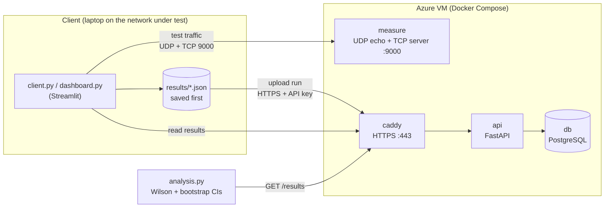

# NetBench

**Can this internet connection carry industrial-automation traffic to the cloud?**
NetBench answers that per network and per traffic type. It replays three automation-style
traffic patterns against a measurement server in the cloud, stores every run centrally, and
rates each network as **meets**, **fails** or **inconclusive** for each test case, based on
confidence intervals rather than single measurements.

## How it works



1. The **client** runs the three test cases against the **measurement server**, which only echoes
   traffic back. All timing happens on the client's clock, so no clock synchronisation is needed.
2. Each run is **saved locally first**, then uploaded to the **API** over HTTPS. If the network
   under test is too bad to upload, the run stays pending and is retried later.
3. The **API** validates each run and stores it in **PostgreSQL**, including the raw per-packet
   round-trip times and the exact parameters and thresholds used.
4. The **Streamlit dashboard** starts tests on site and shows the assessment, metrics over time,
   and every packet of a single run. **`analysis.py`** produces the same assessment as a Markdown report.

## Test cases

Modelled on automation traffic over a remote internet connection (monitoring, remote control,
updates), not on a hard-real-time fieldbus, which needs sub-millisecond cycles that no internet
path can guarantee. Thresholds live in [`netbench/profiles.py`](netbench/profiles.py).

| Test case | Traffic pattern | Imitates | Passes if |
|---|---|---|---|
| `cyclic_udp` | 64-byte UDP packet every 10 ms for 30 s (3,000 packets) | Controller sending cyclic process data | RTT p99 ≤ 50 ms, jitter ≤ 5 ms, loss ≤ 0.1% |
| `reqresp_tcp` | 128 B request → 1 KB response, every 50 ms, 200 times | Polling a device (Modbus/TCP, OPC UA read) | RTT p95 ≤ 100 ms, p99 ≤ 200 ms, 0 errors |
| `bulk_tcp` | 20 MB download | Firmware update, log or recipe transfer | ≥ 10 Mbit/s and complete |

### Metrics

| Metric | Definition |
|---|---|
| RTT | Round-trip time: send timestamp written into the packet, compared with the client's clock when the echo returns |
| Jitter | Mean absolute difference between consecutive RTTs (IP delay variation) |
| Loss | Share of packets sent whose echo never arrived (after a 1 s grace period) |
| Throughput | Bytes received × 8 / transfer time, including TCP slow start |
| Send gap p99 | How evenly the **client** sent cyclic packets. Large values mean the client machine, not the network, distorted the test; such runs are excluded from the assessment |

## Assessment method

- **One run is one observation.** Packets within a run are not independent (a congested second
  delays many packets in a row), so per-packet statistics would give falsely narrow intervals.
- **Verdict from the pass rate.** For each network and test case: the share of runs that met *all*
  thresholds, with a 95% **Wilson** confidence interval. **Meets** if the lower bound is ≥ 90%,
  **fails** if the upper bound is < 90%, otherwise **inconclusive** (collect more runs).
  Proving 90% needs at least 35 runs even if every run passes, so the plan is 40 runs per network.
- **Metrics as medians with bootstrap intervals.** Latency is skewed by occasional spikes, so
  medians over runs are reported with 95% percentile-bootstrap intervals (no normality assumption).
- **Cleaning.** Runs against localhost and cyclic runs with a client send gap p99 above 15 ms are
  excluded. Tests that errored (e.g. connection refused) count as failures: that is a property of
  the network.

## Results

**Status (November 2026): pilot run complete; data collection in progress.** The plan is about
40 runs per network (home Wi-Fi, university network, mobile hotspot) at random times of day.
The results table will be generated with `python -m netbench.analysis`.

**Pilot run:** home Wi-Fi in Saarbrücken → Azure VM in Austria East (Vienna), 2 Nov 2026.

| Test case | Result | Key numbers |
|---|---|---|
| Cyclic UDP | FAIL | median RTT 24.5 ms, **p99 88.5 ms** (limit 50), jitter 2.5 ms, **loss 0.30%** (9 of 3,000 packets; limit 0.1%) |
| Request/response TCP | PASS | median RTT 25.8 ms, p95 29.7 ms, p99 37.5 ms, 0 errors |
| Bulk TCP | PASS | 49.4 Mbit/s |

The cyclic test failed on **tail latency and loss, not on typical delay**: the median was 24.5 ms,
but 1 packet in 100 took more than 3.5 times as long. Jitter stayed low (2.5 ms) because it
averages over all packets, so rare spikes barely move it; p99 catches them. A single run proves
nothing either way, which is what the multi-run assessment is for.

## Running it

Requirements: Python 3.11+, Docker with Compose. The measurement client and server use only the
Python standard library; the dashboard and analysis need `requirements.txt`.

### Locally

```bash
cp .env.example .env            # then set POSTGRES_PASSWORD and NETBENCH_API_KEY
docker compose up --build -d    # API + database
python3 -m venv .venv && source .venv/bin/activate && pip install -r requirements.txt
python -m netbench.server       # in a second terminal: the measurement server

source dev-env.sh               # sets NETBENCH_API_URL, NETBENCH_API_KEY, NETBENCH_SERVER
python -m netbench.client --network localhost-test
streamlit run dashboard.py
python -m netbench.analysis
```

### On a cloud VM

On an Ubuntu VM with Docker (inbound ports: 22/tcp, 80/tcp, 443/tcp, 9000/tcp, 9000/udp):

```bash
git clone https://github.com/AdarshN99/netbench.git && cd netbench
# .env with fresh secrets plus:
#   COMPOSE_PROFILES=prod                      also start "measure" and "caddy"
#   NETBENCH_DOMAIN=<the VM's DNS name>        Caddy fetches a Let's Encrypt certificate for it
docker compose up --build -d
```

On the client, put `NETBENCH_API_URL`, `NETBENCH_API_KEY` and `NETBENCH_SERVER` in `.env.azure`
and run `source dev-env.sh azure`.

## Design decisions

| Decision | Reason |
|---|---|
| Round-trip time, not one-way delay | One-way delay needs clocks synchronised to well under a millisecond (PTP); RTT needs only the client's clock |
| Absolute send schedule (packet *k* at start + *k* × 10 ms) | Late wake-ups don't accumulate into a lower packet rate |
| Raw samples stored, losses kept in position | Summaries can always be recomputed; loss bursts (which trip device watchdogs) are visible only in order |
| Save locally first, upload second | A bad network under test must never lose a measurement |
| Run IDs generated by the client, `ON CONFLICT DO NOTHING` | Retrying an upload after a timeout cannot create duplicates |
| Thresholds stored with every run | Old runs stay interpretable, and can be re-judged, if thresholds change |
| Measurement server on the host network | No Docker address translation in the measured path |
| Database without a published port; API key; HTTPS via Caddy | Only the API can reach the data, and the key never crosses the internet in clear text |

## Limitations

- RTT includes both directions; the test cannot tell where on the path a delay occurred.
- One client machine: its Wi-Fi adapter and OS scheduler are part of every measurement (the send-gap metric detects the latter).
- The thresholds are design choices for remote connectivity, not taken from a standard; they are parameters in `profiles.py`.
- The measurement server is unauthenticated so any client can test; response sizes are capped so it cannot be used to send large amounts of traffic.
- The VM is a burstable B-series instance; the server's load is tiny, but sustained CPU use could add delay.

## Project layout

```
netbench/
├── netbench/
│   ├── client.py      measurement client (CLI) and the three test runners
│   ├── server.py      UDP echo + TCP request/response and bulk server
│   ├── protocol.py    wire format shared by client and server
│   ├── profiles.py    test cases and thresholds
│   ├── results.py     run records (JSON)
│   ├── upload.py      offline-first upload and API reads
│   └── analysis.py    statistical assessment and Markdown report
├── backend/           FastAPI app, SQL schema, Dockerfile
├── dashboard.py       Streamlit front-end
├── Dockerfile         image for the measurement server
├── Caddyfile          HTTPS reverse proxy
├── docker-compose.yml db + api (dev); + measure + caddy with COMPOSE_PROFILES=prod
└── dev-env.sh         sets up a terminal for local or Azure use
```
